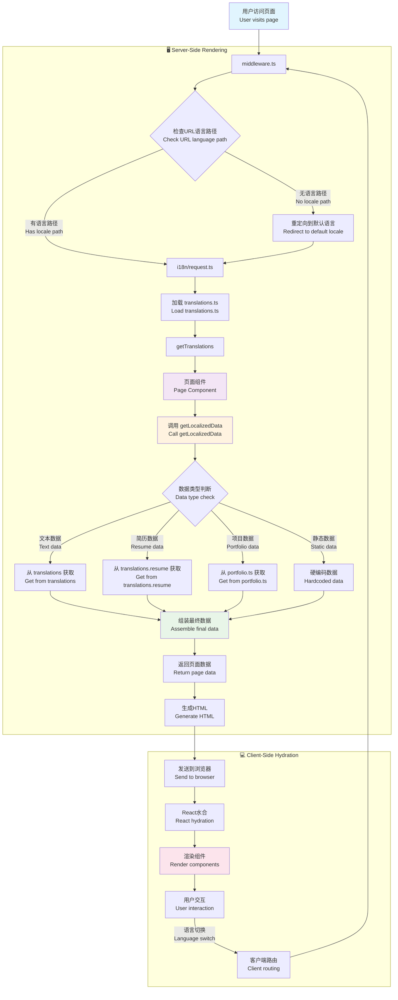

# 数据组织指南 / Data Organization Guide

本文档说明如何在此项目中组织和管理数据，以及数据如何在多语言环境下加载和显示。
所有用户可见文本通过 translations.ts 管理


## 📁 File Structure

### 核心数据文件 / Core Data Files
```
src/
├── data/
│   ├── README.md              # 本文档
│   ├── dataDef.ts            # TypeScript 类型定义
│   ├── localizedData.tsx     # 多语言数据配置 (主要入口)
│   └── portfolio.ts          # 项目展示数据 (语言无关)
├── i18n/
│   ├── request.ts            # Next.js 国际化配置
│   └── translations.ts       # 翻译文本 & 简历数据
├── images/
│   ├── portfolio/            # 项目截图
│   └── ...                   # 其他图片资源
└── middleware.ts             # 路由语言处理
```

### 数据类型层次 / Data Type Hierarchy
- **TypeScript 类型** (`dataDef.ts`): Hero, About, PortfolioItem, TimelineItem, Social
- **翻译接口** (`translations.ts`): Translations, TimelineItemData
- **数据入口** (`localizedData.tsx`): getLocalizedData() 函数

## 🔄 Data Load Flow



### 数据加载优先级 / Data Loading Priority
1. **语言检测** - URL路径 → Cookie偏好 → 默认语言(en)
2. **翻译加载** - 根据语言加载对应的translations
3. **数据组装** - 合并静态数据与翻译数据
4. **组件渲染** - 传递最终数据到React组件

### 关键函数调用链 / Key Function Call Chain
```typescript
middleware() → request.ts → getTranslations() → getLocalizedData() → Components
```

## 🌍 I18n (Internationalization)

### 支持的语言 / Supported Languages
| 语言 | 代码 | 状态 | 示例路径 |
|------|------|------|----------|
| English | `en` | ✅ 默认 | `/en/` |
| Deutsch | `de` | ✅ 完整 | `/de/` |
| 中文 | `zh` | ✅ 完整 | `/zh/` |

### 多语言架构 / Multilingual Architecture

#### 1. 路由层 (Route Level)
```typescript
// middleware.ts
const locales = ['en', 'de', 'zh'];
const defaultLocale = 'en';

// URL结构: /{locale}/{page}
// 例如: /en/, /de/about, /zh/portfolio
```

#### 2. 配置层 (Configuration Level)  
```typescript
// i18n/request.ts
export default getRequestConfig(async ({locale}) => {
  return {
    locale: locale || "en",
    messages: getTranslations(locale),
  };
});
```

#### 3. 数据层 (Data Level)
```typescript
// translations.ts - 文本和简历数据
export const translations: Record<string, Translations> = {
  en: { meta: {...}, hero: {...}, resume: {...} },
  de: { meta: {...}, hero: {...}, resume: {...} },
  zh: { meta: {...}, hero: {...}, resume: {...} }
};

// localizedData.tsx - 数据组装
export function getLocalizedData(locale: string) {
  const t = getTranslations(locale);
  // 组装所有页面数据...
}
```

### 添加新语言 / Adding New Languages

1. **更新语言列表**:
```typescript
// middleware.ts
const locales = ['en', 'de', 'zh', 'fr']; // 添加法语
```

2. **添加翻译数据**:
```typescript
// translations.ts
export const translations = {
  // ... 现有语言
  fr: {
    meta: { title: "Hanbin Chen - Portfolio Personnel", ... },
    hero: { name: "Je suis Hanbin Chen.", ... },
    // ... 完整翻译
  }
};
```

3. **测试多语言路由**:
- `/fr/` - 法语首页
- `/fr/portfolio` - 法语项目页面

### 最佳实践 / Best Practices

#### ✅ 推荐做法
- 所有用户可见文本通过 `translations.ts` 管理
- 复杂数据结构(如简历)也使用i18n模式
- 图片和URL等语言无关数据可以共享
- 使用TypeScript确保翻译完整性

#### ❌ 避免做法  
- 在组件中硬编码多语言文本
- 混合使用不同的国际化方案
- 忘记为新文本添加所有语言的翻译
- 在 `localizedData.tsx` 中重复语言数据

### 组件使用示例 / Component Usage Example
```typescript
// 在页面组件中
export default function HomePage({ params: { locale } }) {
  const data = getLocalizedData(locale);
  
  return (
    <div>
      <Hero data={data.heroData} />
      <About data={data.aboutData} />
      <Portfolio items={data.portfolioItems} />
      <Resume 
        education={data.education} 
        experience={data.experience} 
      />
    </div>
  );
}
```
